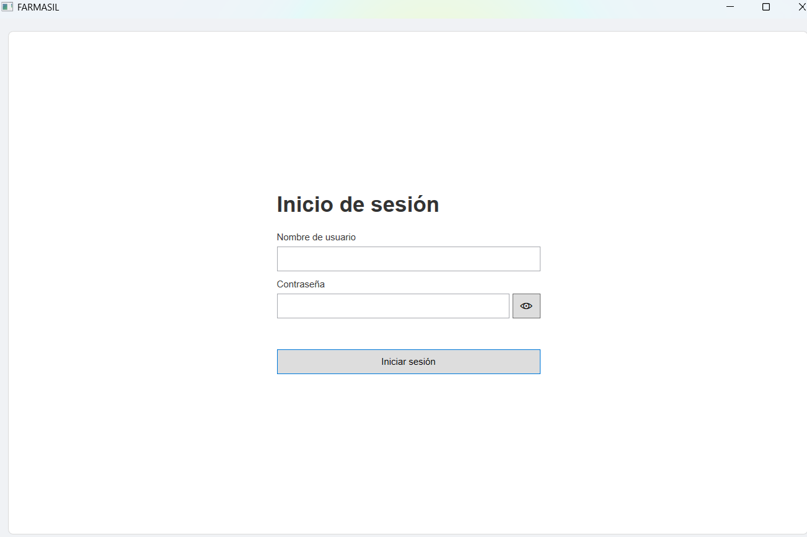
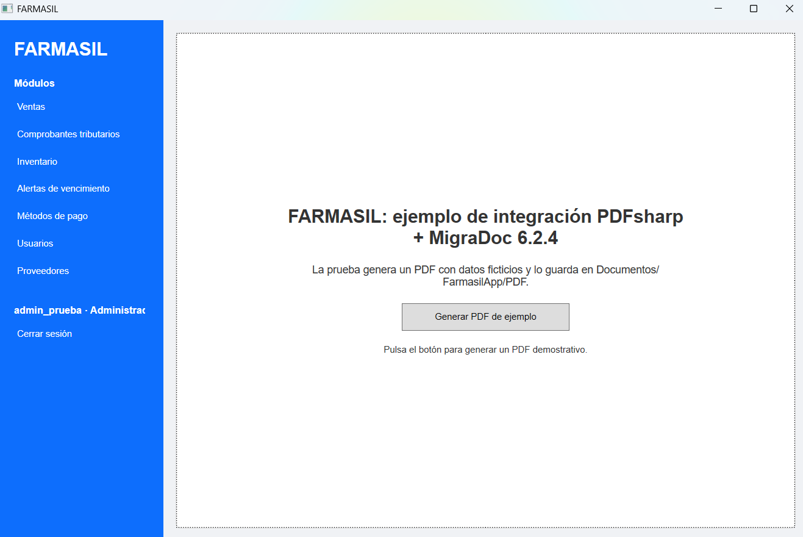
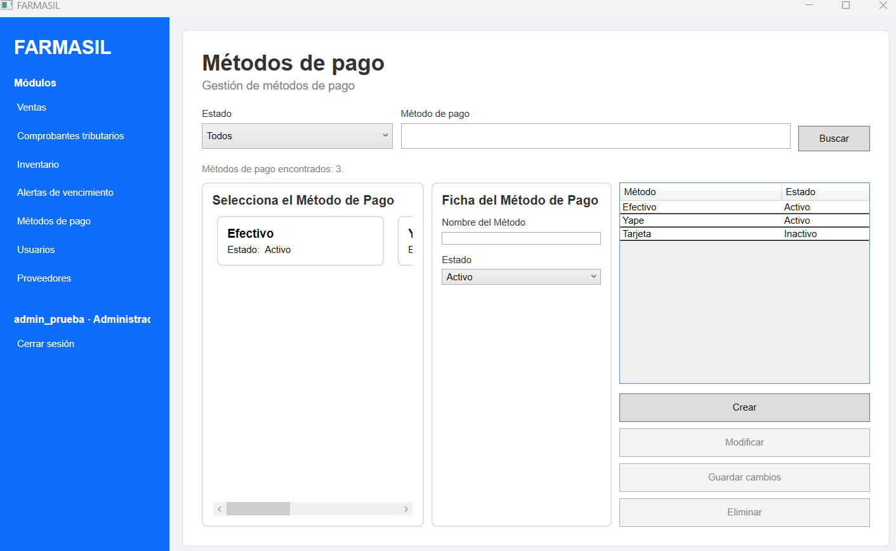
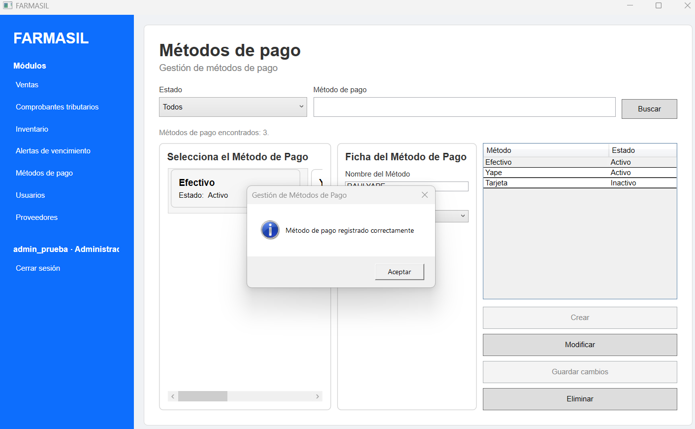
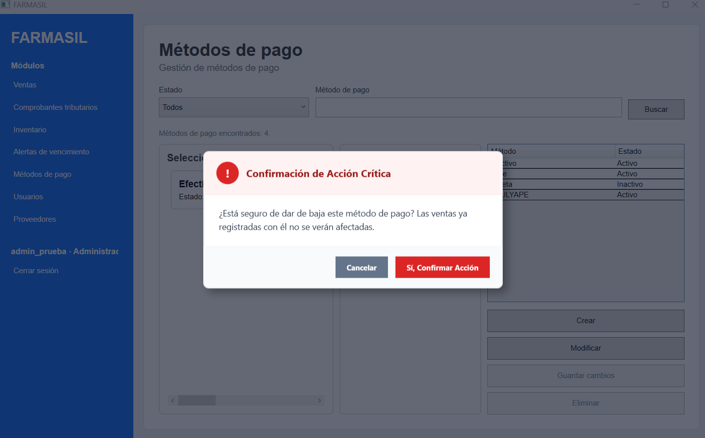
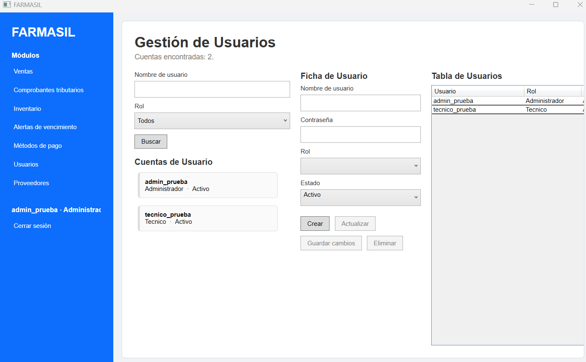
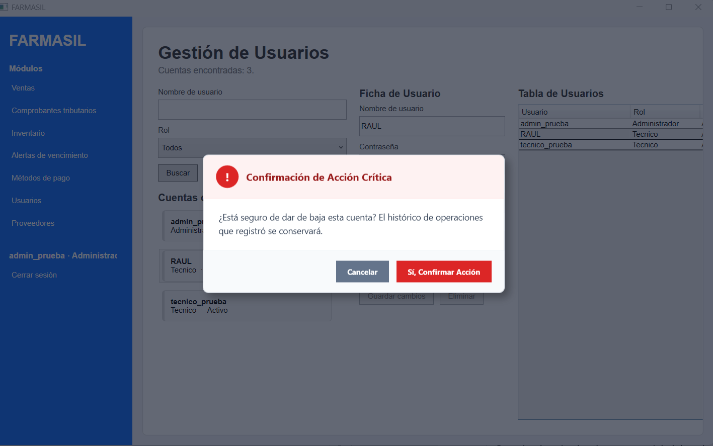

# Manual de usuario de FARMASIL

| Artefacto | Manual de usuario |
| --- | --- |
| Versión | 01.00 |
| Fecha | 25/11/2026 |
| Responsable | R4 — Pruebas exploratorias y documentación de usuario |

## Historial de versiones

| Versión | Fecha | Cambio |
| --- | --- | --- |
| 01.00 | 25/11/2026 | Primera versión (issue #93): índice por módulo, inicio de sesión, ventana principal, Usuarios y Métodos de pago. El borrador estaba en la guía exploratoria (versión 02.00). |

## Índice

1. [Introducción](#introduccion)
2. [Inicio y cierre de sesión](#inicio-y-cierre-de-sesion)
3. [Ventana principal y menú](#ventana-principal-y-menu)
4. Ventas (VEN) — pendiente.
5. Inventario (INV) — pendiente.
6. Comprobantes tributarios (DOC) — pendiente.
7. Alertas de vencimiento (ALV) — pendiente.
8. [Métodos de pago (PAG)](#metodos-de-pago-pag)
9. Reportes de ventas (REP) — pendiente.
10. Devoluciones a proveedores (DEV) — pendiente.
11. Restricciones de venta (RES) — pendiente.
12. [Usuarios (USR)](#usuarios-usr)
13. Proveedores (PRV) — pendiente.
14. Lotes (LOT) — pendiente.
15. Reabastecimiento (REA) — pendiente.
16. Comparación de precios de proveedores (COT) — pendiente.
17. Anexos: mensajes del sistema y glosario — pendiente.

Los capítulos pendientes se escriben cuando su módulo está terminado.

## Introducción

FARMASIL es la aplicación de escritorio de la botica para registrar ventas, controlar el inventario y sus remesas, y llevar los datos de apoyo: proveedores, métodos de pago y cuentas de usuario.

Hay dos roles:

| Rol | Qué puede hacer |
| --- | --- |
| Administrador | Todo: consultar y también registrar, modificar y dar de baja. Es el único que gestiona usuarios y proveedores. |
| Técnico | Atender: registrar y consultar ventas, emitir comprobantes y consultar el inventario, las alertas y los métodos de pago. |

Lo que tu rol no permite se ve deshabilitado. Si pasas el cursor por encima, dice por qué, por ejemplo: «Solo disponible para el Administrador.».

## Inicio y cierre de sesión

1. Escribe tu nombre de usuario y tu contraseña. La contraseña se ve como puntos; el botón del ojo la muestra u oculta.
2. Pulsa **Iniciar sesión**.
3. Si los datos no coinciden, aparece «Usuario o contraseña incorrectos.» y la contraseña se borra. Vuelve a escribirla.
4. Si tu cuenta está inactiva, aparece «La cuenta está inactiva. Consulte con un administrador.».

Para salir, pulsa **Cerrar sesión**, debajo de tu nombre en el menú. Vuelves a la pantalla de inicio de sesión.

## Ventana principal y menú

A la izquierda está el menú con los módulos; debajo, tu nombre de usuario, tu rol y **Cerrar sesión**. Pulsa un módulo para abrirlo a la derecha.

| Módulo | Administrador | Técnico |
| --- | --- | --- |
| Ventas | Sí | Sí |
| Comprobantes tributarios | Sí | Sí |
| Inventario | Sí | Solo consulta |
| Alertas de vencimiento | Sí | Sí |
| Métodos de pago | Sí | Solo consulta |
| Usuarios | Sí | No |
| Proveedores | Sí | No |

## Métodos de pago (PAG)

Los métodos de pago son las formas en que el cliente paga una venta: efectivo, Yape, tarjeta… Solo los métodos **Activos** se ofrecen al registrar una venta.

Los dos roles pueden consultar. Solo el Administrador puede crear, modificar y dar de baja.

### Consultar métodos de pago

1. Abre **Métodos de pago** en el menú. La pantalla muestra todos los métodos.
2. Para filtrar, escribe parte del nombre en **Método de pago**, elige un **Estado** («Todos», «Activo» o «Inactivo») y pulsa **Buscar**. Sin criterios, aparecen todos.
3. El resultado se ve en tarjetas y en la tabla de la derecha. Pulsa una tarjeta o una fila para ver el método en la ficha.

### Crear un método de pago

1. Escribe el nombre en la ficha, en **Nombre del Método**, y elige el **Estado**.
2. Pulsa **Crear**. Aparece «Método de pago registrado correctamente».

El nombre es obligatorio, tiene como máximo 50 caracteres y no puede repetir el de otro método (sin importar mayúsculas).

### Modificar un método de pago

1. Selecciona el método en una tarjeta o en la tabla.
2. Pulsa **Modificar**, cambia el nombre o el estado y pulsa **Guardar cambios**. Aparece «Método de pago actualizado correctamente».

Si lo pasas a **Inactivo**, deja de ofrecerse en las ventas nuevas; las ventas ya registradas no cambian.

### Dar de baja un método de pago

1. Selecciona el método y pulsa **Eliminar**.
2. Confirma con **Sí, Confirmar Acción**, o pulsa **Cancelar** (o Escape) para no hacer nada.

Si el método nunca se usó en una venta, se elimina. Si ya se usó, queda **Inactivo** para conservar las ventas registradas.

## Usuarios (USR)

Aquí se gestionan las cuentas con las que se entra a FARMASIL. Solo el Administrador puede abrir este módulo. Las contraseñas nunca se muestran en la lista.

### Consultar cuentas

1. Abre **Usuarios** en el menú. La pantalla muestra todas las cuentas.
2. Para filtrar, escribe el nombre de usuario, elige un **Rol** («Todos», «Administrador» o «Tecnico») y pulsa **Buscar**.
3. Las cuentas se ven en tarjetas y en la **Tabla de Usuarios**, con su rol y estado. Pulsa una tarjeta o una fila para cargar la cuenta en la ficha.

### Crear una cuenta

1. En la **Ficha de Usuario**, escribe el nombre de usuario y la contraseña, y elige el rol y el estado.
2. Pulsa **Crear**. Aparece «Usuario registrado correctamente».

El nombre de usuario es obligatorio, tiene como máximo 50 caracteres y no puede repetir el de otra cuenta (sin importar mayúsculas). La contraseña es obligatoria.

### Actualizar una cuenta

1. Selecciona la cuenta y pulsa **Actualizar**. La contraseña aparece vacía.
2. Cambia lo que necesites. Si dejas la contraseña vacía, se conserva la actual; si escribes una, la reemplaza.
3. Pulsa **Guardar cambios**. Aparece «Usuario actualizado correctamente».

Reglas:

- Siempre debe quedar al menos una cuenta de Administrador activa.
- No puedes cambiar el rol ni el estado de la cuenta con la que entraste; sí su nombre y su contraseña.

### Dar de baja una cuenta

1. Selecciona la cuenta y pulsa **Eliminar**.
2. Confirma con **Sí, Confirmar Acción**, o pulsa **Cancelar** (o Escape) para no hacer nada.

Si la cuenta nunca registró operaciones, se elimina. Si las registró, queda **Inactivo**: ya no puede entrar, pero sus ventas y demás registros se conservan. No puedes dar de baja la cuenta con la que entraste.
